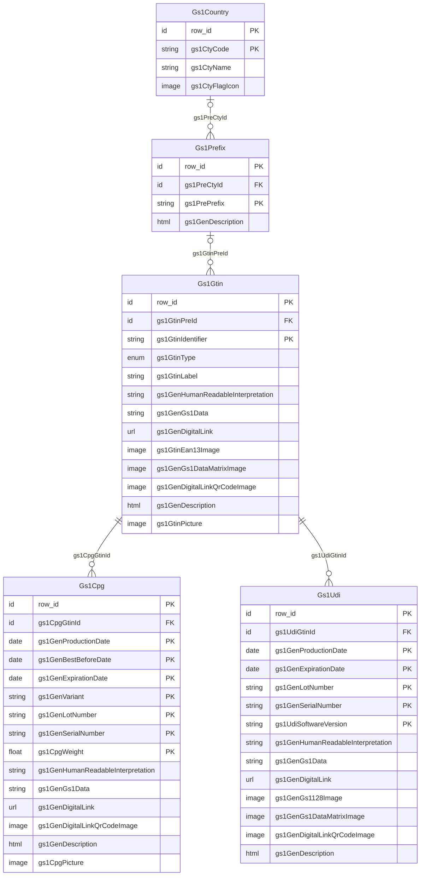

# User:designer

## General informations

**Name**:  Designer

**Preferred date format**: MM/DD/YYYY

**Preferred number format**: CD


# Module: Gs1Demo

This module contains a demo of [GS1 standards](https://www.gs1.org) standards
within Simplicité.

## Relationships



## Domains

Domains organize the application's main navigation menu. Each domain groups the objects, processes, and external pages accessible to users from it. Domains can be nested: a domain may have a parent domain.

```yaml
Gs1Demo:
  parent: ~
  items:
    - name: Gs1Gtin
      type: object
    - name: Gs1Udi
      type: object
    - name: Gs1Cpg
      type: object
Gs1DemoRefData:
  parent: Gs1Demo
  items:
    - name: Gs1Country
      type: object
    - name: Gs1Prefix
      type: object
```

## Gs1Cpg

```yaml
label: Consumer product
table: gs1_cpg
```

Consumer product
----------------

### Digital links

- in path:
  - `01`: GTIN (key)
  - `22`: consumer product variant (optional)
  - `10`: batch or lot number (optional)
  - `21`: serial number (optional)
- in query string:
  - `17`: expiry date (`YYMMDD`, optional)
  - `15`: best-before date (`YYMMDD`, optional)
  - `11`: production date (`YYMMDD`, optional)
  - `3103`: net weight in kg (numer with 3 decimal places, optional)

### Relationships

```yaml
belongs_to:
  - Gs1Gtin (gs1CpgGtinId, required, on parent delete: cascade)
has_many: []
```

### Fields

```yaml
auto:
  gs1GenHumanReadableInterpretation: char(100)  # HRI (human readable interpretation) [col:gs1_gen_human_readable_interpretation]
  gs1GenGs1Data: char(100)  # GS1 data [col:gs1_gen_gs1_data]
  gs1GenDigitalLink: url(255)  # Digital link [col:gs1_gen_digital_link]
  gs1GenDigitalLinkQrCodeImage: image  # Digital link QRCode image [col:gs1_gen_digital_link_qr_code_image]

optional:
  gs1GenProductionDate: date  # Production date [unique key] [col:gs1_gen_production_date]
  gs1GenBestBeforeDate: date  # Best before date [unique key] [col:gs1_gen_best_before_date]
  gs1GenExpirationDate: date  # Expiration date [unique key] [col:gs1_gen_expiration_date]
  gs1GenVariant: regexp(20)  # [unique key] [col:gs1_gen_variant]
  gs1GenLotNumber: regexp(20)  # Lot number [unique key] [col:gs1_gen_lot_number]
  gs1GenSerialNumber: regexp(20)  # Serial number [unique key] [col:gs1_gen_serial_number]
  gs1CpgWeight: float(10, 3)  # [unique key] [col:gs1_cpg_weight]
  gs1GenDescription: html(1000000)  # Prefix description [col:gs1_gen_description]
  gs1CpgPicture: image  # [col:gs1_cpg_picture]

referenced:
  gs1GtinIdentifier: char(14)  # GTIN identifier [col:gs1_gtin_identifier]
  gs1GtinLabel: char(255)  # GTIN label [col:gs1_gtin_label]
  gs1GtinEan13Image: image  # [col:gs1_gtin_ean13_image]

```

### Hooks

```yaml
postValidate: ~
```

---

## Gs1Gtin

```yaml
label: GTIN
table: gs1_gtin
```

`GTIN`: Internationally unique product identifier managed by the GS1 Organization

### Relationships

```yaml
belongs_to:
  - Gs1Prefix (gs1GtinPreId, optional, on parent delete: set-null)  # gtin reference to contry prefix
has_many:
  - Gs1Cpg via gs1CpgGtinId [on delete: cascade, visible]
  - Gs1Udi via gs1UdiGtinId [on delete: cascade, visible]
```

### Fields

```yaml
auto:
  gs1GenHumanReadableInterpretation: char(100)  # HRI (human readable interpretation) [col:gs1_gen_human_readable_interpretation]
  gs1GenGs1Data: char(100)  # GS1 data [col:gs1_gen_gs1_data]
  gs1GenDigitalLink: url(255)  # Digital link [col:gs1_gen_digital_link]
  gs1GtinEan13Image: image  # [col:gs1_gtin_ean13_image]
  gs1GenGs1DataMatrixImage: image  # GS1 data matrix image [col:gs1_gen_gs1_data_matrix_image]
  gs1GenDigitalLinkQrCodeImage: image  # Digital link QRCode image [col:gs1_gen_digital_link_qr_code_image]

required:
  gs1GtinIdentifier: char(14)  # GTIN identifier [unique key] [col:gs1_gtin_identifier] [regex:^[0-9]+$]
  gs1GtinType: enum(50) using GS1_GTIN_TYPE list  # GTIN type [col:gs1_gtin_type]
  gs1GtinLabel: char(255)  # GTIN label [col:gs1_gtin_label]

optional:
  gs1GenDescription: html(1000000)  # Prefix description [col:gs1_gen_description]
  gs1GtinPicture: image  # GTIN picture [col:gs1_gtin_picture]

referenced:
  gs1PrePrefix: char(3)  # Prefix [col:gs1_pre_prefix]
  gs1PreCtyId: id  # Reference to country [col:gs1_pre_cty_id]
  gs1CtyCode: char(3)  # Country code (3 letters) [col:gs1_cty_code]
  gs1CtyName: char(100)  # Country name [col:gs1_cty_name]

```

### Enumerations

```yaml
GS1_GTIN_TYPE:
  MEDICAL_DEVICE: Medical device
  CONSUMER_PRODUCT: Consumer product
  OTHER: Other
```

### Hooks

```yaml
postValidate: ~
canReference: ~
```

---

## Gs1Prefix

```yaml
label: Country prefix
table: gs1_prefix
```

GS1 prefixes

### Relationships

```yaml
belongs_to:
  - Gs1Country (gs1PreCtyId, optional, on parent delete: set-null)  # reference to country
has_many:
  - Gs1Gtin via gs1GtinPreId [on delete: set-null, visible]
```

### Fields

```yaml
required:
  gs1PrePrefix: char(3)  # Prefix [unique key] [col:gs1_pre_prefix]

optional:
  gs1GenDescription: html(1000000)  # Prefix description [col:gs1_gen_description]

referenced:
  gs1CtyCode: char(3)  # Country code (3 letters) [col:gs1_cty_code]
  gs1CtyName: char(100)  # Country name [col:gs1_cty_name]

```

---

## Gs1Udi

```yaml
label: Medical device
table: gs1_udi
```

Medical device
--------------

A mdeical device is identified by a `UDI` (medical device universal identifier).

A `UDI` is composed of:

- a `UDI-DI`: static _device identifier_ (= the GTIN)
- a `UDI-PI`: _production identifiers_

### Digital links syntax

- in path:
  - `01`: GTIN (key)
  - `10`: batch or lot number (optional)
  - `21`: serial number (optional)
- in query string:
  - `17`: expiry date (`YYMMDD`, optional)
  - `11`: production date (`YYMMDD`, optional)
  - `8012`: software version (optional)

### Relationships

```yaml
belongs_to:
  - Gs1Gtin (gs1UdiGtinId, required, on parent delete: cascade)  # reference to gtin
has_many: []
```

### Fields

```yaml
auto:
  gs1GenHumanReadableInterpretation: char(100)  # HRI (human readable interpretation) [col:gs1_gen_human_readable_interpretation]
  gs1GenGs1Data: char(100)  # GS1 data [col:gs1_gen_gs1_data]
  gs1GenDigitalLink: url(255)  # Digital link [col:gs1_gen_digital_link]
  gs1GenGs1128Image: image  # GS1 128 barcode image [col:gs1_gen_gs1128_image]
  gs1GenGs1DataMatrixImage: image  # GS1 data matrix image [col:gs1_gen_gs1_data_matrix_image]
  gs1GenDigitalLinkQrCodeImage: image  # Digital link QRCode image [col:gs1_gen_digital_link_qr_code_image]

optional:
  gs1GenProductionDate: date  # Production date [unique key] [col:gs1_gen_production_date]
  gs1GenExpirationDate: date  # Expiration date [unique key] [col:gs1_gen_expiration_date]
  gs1GenLotNumber: regexp(20)  # Lot number [unique key] [col:gs1_gen_lot_number]
  gs1GenSerialNumber: regexp(20)  # Serial number [unique key] [col:gs1_gen_serial_number]
  gs1UdiSoftwareVersion: regexp(20)  # Medical device software version [unique key] [col:gs1_udi_software_version]
  gs1GenDescription: html(1000000)  # Prefix description [col:gs1_gen_description]

referenced:
  gs1GtinIdentifier: char(14)  # GTIN identifier [col:gs1_gtin_identifier]
  gs1GtinLabel: char(255)  # GTIN label [col:gs1_gtin_label]
  gs1GtinEan13Image: image  # [col:gs1_gtin_ean13_image]

```

### Hooks

```yaml
postValidate: ~
```

---

## Gs1Country

```yaml
label: Country
table: gs1_country
```

ISO 3166-1 countries

### Relationships

```yaml
belongs_to: []
has_many:
  - Gs1Prefix via gs1PreCtyId [on delete: set-null, visible]
```

### Fields

```yaml
required:
  gs1CtyCode: char(3)  # Country code (3 letters) [unique key] [col:gs1_cty_code]
  gs1CtyName: char(100)  # Country name [col:gs1_cty_name]

optional:
  gs1CtyFlagIcon: image  # Country flag [col:gs1_cty_flag_icon]

```

---

